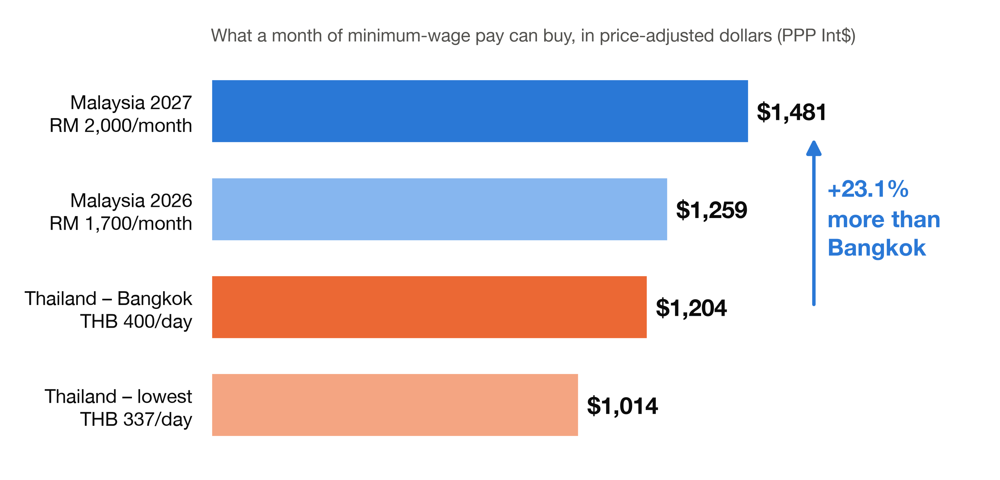
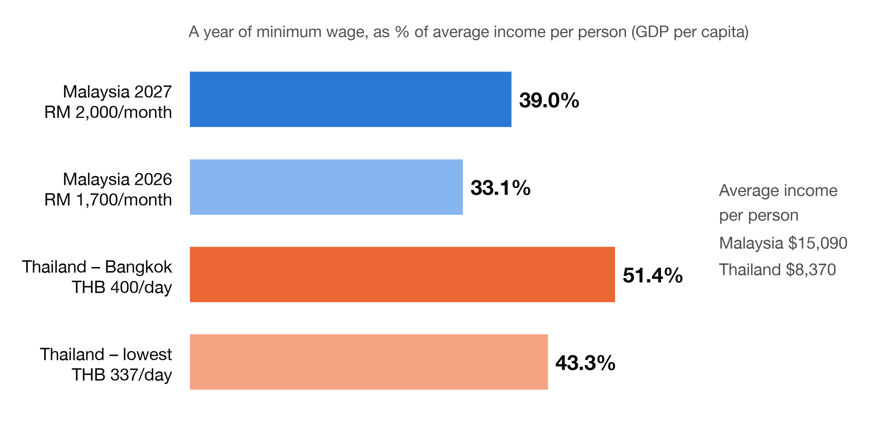
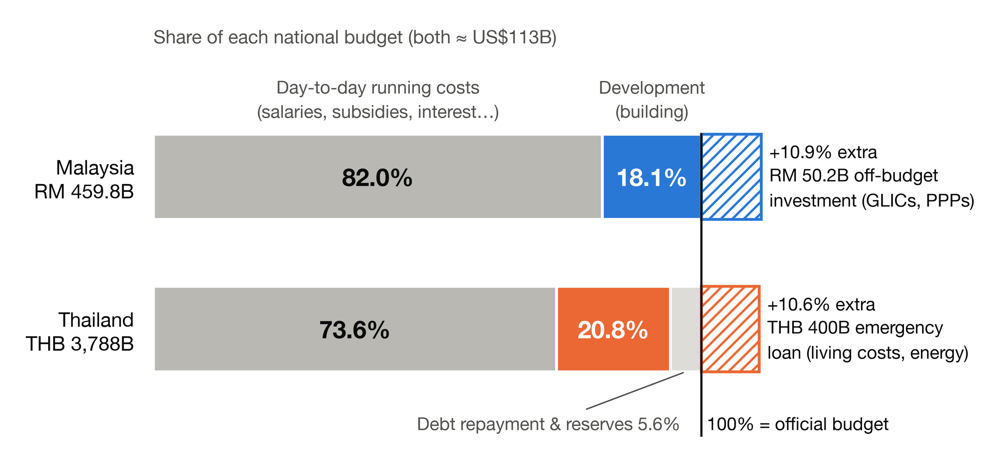

# Bigger Pay Packet or Bigger Building Budget?
### Malaysia's Budget 2027 vs Thailand's FY2027 Budget — minimum wage and where the money goes

Malaysia and Thailand each plan to spend about **US$113 billion** in 2027, almost exactly the same amount. They use it in very different ways.
**Malaysia** is raising the minimum wage and putting more money directly into household pockets. **Thailand** is protecting its spending on infrastructure and has borrowed separately to help with living costs.

This page backs up the infographic poster for **AA037003 Task 1**. It shows every number on the poster, explains what each number means in plain English, lists every source, and shows how to recreate the charts from scratch.

---

## The 30-second version

1. **Malaysian minimum-wage workers can buy more.** After allowing for the fact that things are cheaper in Thailand, Malaysia's new RM 2,000 minimum wage buys **23.1% more** than Bangkok's minimum wage and **46.1% more** than Thailand's lowest minimum wage.
2. **Malaysia can afford it because its economy produces more per person.** Average income per person in Malaysia ($15,090) is **1.8×** Thailand's ($8,370). A full year of Malaysia's new minimum wage equals **39.0%** of average income. Bangkok's minimum wage already equals **51.4%**. A Thai pay rise would therefore hit Thai employers harder.
3. **The budgets have the same size but different priorities.** Malaysia spends **82.0%** of its budget on day-to-day costs (salaries, subsidies and so on) and **18.1%** on development (building things). Thailand spends **73.6%** day-to-day and **20.8%** on development. Each country also has an extra pot of roughly **11%** outside the official budget. Malaysia's extra pot is investment by government-linked funds. Thailand's is an emergency loan to help with living and energy costs.

---

## The charts

All charts are in [`outputs/charts/`](outputs/charts/). Each one comes in three versions:

| Folder | Use it for |
|:--|:--|
| `png_white/` | Dropping straight onto a white or light poster |
| `png_transparent/` | Placing on a coloured or light-tinted Canva background (the text is dark) |
| `svg/` | Resizing without losing sharpness (Canva accepts SVG uploads) |

The charts have no titles, so you can write your own headline in Canva. Malaysia is always **blue** and Thailand is always **orange**.

### Chart 1 — What does a month of minimum wage actually buy?



**What it shows:** Each country's monthly minimum wage, converted into "price-adjusted dollars". This is a common yardstick that removes the effect of different price levels, so RM 1 and THB 1 are compared by what they actually buy in shops at home.

**Key finding:** Malaysia's RM 2,000 wage (from June 2027) is worth **Int$ 1,481** a month. Bangkok's THB 400/day is worth **Int$ 1,204**, and Thailand's lowest rate (THB 337/day) is worth **Int$ 1,014**. Malaysia's lead is **+23.1%** over Bangkok and **+46.1%** over Thailand's lowest rate.

**Why the adjustment matters:** In plain US dollars Malaysia's lead looks bigger (**+36.6%**: $490 vs $359). Prices in Thailand are lower, though, so a baht stretches further. Adjusting for prices shrinks Malaysia's lead, but Malaysia still comes out clearly ahead.

**Why it matters:** The **RM 2,000** minimum is a **+17.65%** rise from RM 1,700 and reaches **over 4 million workers**. It is the biggest direct boost to low-income households in the budget.

### Chart 2 — How heavy is the minimum wage compared with what the economy produces?



**What it shows:** A full year of minimum wage as a percentage of GDP per capita (the value the economy produces per person, a rough measure of average income). A higher % means the minimum wage is a bigger stretch for the economy and for employers.

**Key finding:** The ranking **flips**. Malaysia pays the most in real terms (Chart 1), but its minimum wage is the **lightest** burden relative to income. Malaysia rises from **33.1%** to **39.0%**, while Thailand is already at **43.3%** (lowest rate) and **51.4%** (Bangkok).

**Why it matters:** Malaysia produces **1.8×** more per person, so it can afford a higher minimum wage. Even so, the budget exempts small and medium businesses with yearly sales **below RM 50 million** from the new rate for now. Thailand is already at half of average income in Bangkok. That helps explain why it has not pushed for a large nationwide minimum-wage rise and has used targeted relief instead.

### Chart 3 — Where does each budget go?



**What it shows:** How each official budget (100%) is split, plus the extra money each government raised **outside** the official budget (hatched bars).

**Key finding:**
- **Malaysia (RM 459.8B):**
  - **82.0%** goes to day-to-day running costs. That includes **RM 80B+ (17.4%)** in subsidies and cash aid, such as RM 40B for fuel subsidies and RM 16B for STR/SARA cash aid.
  - Only **18.1% (RM 83.0B)** goes to development.
  - On top of that, government-linked investment funds and private partners add **RM 50.2B (+10.9%)**, bringing the total to **RM 510B**.
- **Thailand (THB 3,788B):**
  - **73.6%** goes to day-to-day costs.
  - **20.8%** goes to development. Thai law requires at least 20%.
  - **5.6%** goes to debt repayment and reserves.
  - Separately, Thailand approved a **THB 400B emergency loan** (equal to **+10.6%** of the budget) for living-cost and energy relief.

**Why it matters:** If you only look at the official budget, you miss half the story. Malaysia pays for household help **inside** the budget and pushes building projects **outside** it, to government-linked investment funds. Thailand protects building **inside** the budget and pays for household relief with **borrowed money outside** it.

---

## Poster cheat sheet

Copy these straight onto the poster. Every value is generated by the code in [`outputs/findings.json`](outputs/findings.json).

| What | Malaysia | Thailand |
|:--|:--|:--|
| Total 2027 budget | RM 459.8B (≈ US$112.7B) | THB 3,788B (≈ US$113.2B) |
| Minimum wage | RM 1,700 → **RM 2,000/month** (June 2027, +17.65%) | **THB 337–400/day** (≈ THB 10,110–12,000/month) |
| Minimum wage in US$ | $490/month | $302–$359/month |
| Minimum wage, price-adjusted | **Int$ 1,481** | Int$ 1,014–1,204 |
| Malaysia's real-wage lead | **+23.1%** vs Bangkok, **+46.1%** vs lowest Thai rate | — |
| Year of min. wage ÷ average income | 33.1% → **39.0%** | **43.3%** – **51.4%** |
| Average income per person (GDP per capita) | $15,090 | $8,370 |
| Day-to-day spending | **82.0%** | **73.6%** |
| Development (building) | **18.1%** (RM 83.0B) | **20.8%** (THB 789B) |
| Subsidies & cash aid | 17.4% (RM 80B+) | — |
| Debt repayment & reserves | — | 5.6% |
| Extra money outside the budget | **+RM 50.2B investment (+10.9%)** | **+THB 400B emergency loan (+10.6%)** |

**Short captions (about 40 words each):**

> **Chart 1:** After adjusting for prices, Malaysia's new RM 2,000 minimum wage buys 23.1% more than Bangkok's and 46.1% more than Thailand's lowest rate. The hike (+17.65%) lifts real pay for over 4 million Malaysian workers.

> **Chart 2:** The ranking flips. Malaysia's minimum wage equals 39.0% of average income, but Bangkok's already equals 51.4%. Producing 1.8× more per person lets Malaysia raise wages without overloading employers.

> **Chart 3:** The budgets are the same size with opposite strategies. Malaysia spends 82.0% day-to-day and adds RM 50.2B in off-budget investment. Thailand keeps 20.8% for development and borrows THB 400B separately for living-cost relief.

**One-line takeaway:** *Malaysia invests in people's pay packets. Thailand protects its building budget and borrows to cushion households.*

---

## Jargon translator

| Term | Plain English |
|:--|:--|
| **Purchasing power parity (PPP)** / **Int$** | A "price-adjusted dollar". It converts money using what it buys locally, not the exchange rate, so a haircut in KL and in Bangkok count as equal value. |
| **Price level index** | How expensive a country is compared with the US (US = 100). Malaysia is 33.1 and Thailand is 29.8, so Thailand is a bit cheaper. |
| **GDP per capita** | The total value a country produces in a year, divided by its population. It works as a rough "average income per person". |
| **Operating / recurrent expenditure** | Day-to-day running costs: civil-servant salaries, pensions, subsidies, interest on debt. |
| **Development / capital expenditure** | Spending on things that last: roads, schools, hospitals, railways. |
| **Off-budget** | Money that is not in the official budget. It comes from government-linked companies (GLICs such as Khazanah, EPF and PNB), public–private partnerships, or a special loan decree. |
| **GLIC** | Government-Linked Investment Company: big state-connected investment funds in Malaysia. |
| **STR / SARA** | Malaysia's cash-aid programmes for lower-income households (Sumbangan Tunai Rahmah / Sumbangan Asas Rahmah). |
| **Emergency loan decree** | A special law letting the Thai government borrow outside the normal budget process. |
| **MSME** | Micro, small and medium enterprises: small businesses. |

---

## How the numbers are calculated

Everything comes from one data file, [`data/raw/asean_fiscal_wage_2027.csv`](data/raw/asean_fiscal_wage_2027.csv), plus the headline budget totals quoted in the sources below.

| Number | Formula |
|:--|:--|
| Minimum wage in US$ | monthly wage ÷ exchange rate (RM 4.0805/US$, THB 33.45/US$) |
| Price-adjusted wage (Int$) | monthly wage ÷ PPP rate (RM 1.35, THB 9.97 per Int$) |
| Real-wage lead | (Malaysia Int$ ÷ Thailand Int$ − 1) × 100 |
| Year of wage ÷ average income | 12 × monthly US$ wage ÷ GDP per capita × 100 |
| Thai monthly wage | 30 × daily rate (the standard monthly-salary basis) |
| Budget shares | Spending category ÷ total budget × 100 |
| Off-budget size | RM 50.2B ÷ RM 459.8B; THB 400B ÷ THB 3,788B |

The test suite checks automatically that:
- the data file has not been altered (a fingerprint check)
- every derived column can be recalculated from the raw inputs
- budget shares add up to 100%
- every label on every chart matches the computed findings
- this README agrees with `findings.json`

### Honest caveats

- **Thai daily-paid workers.** Thai monthly wages here assume 30 paid days. Many casual workers are paid for about 26 days, which is 13.3% less (THB 8,762–10,400 a month). On that basis Malaysia's real-wage lead grows to **+42.0%** over Bangkok and **+68.6%** over the lowest Thai rate.
- **Thailand's GDP per capita** in the dataset ($8,370) is slightly higher than some other IMF-based figures for 2026 (about $7,980–$8,100). Using a lower figure would make Thailand's ratios in Chart 2 *higher* still, so the conclusion does not change.
- **The THB 400B loan is not part of the FY2027 Budget Act.** It was approved in May 2026. It is shown as "equal to 10.6% of the budget" only to compare its size.
- **Malaysia's subsidies figure** (RM 80B+, 17.4%) is the "subsidies, aid and incentives" total from the budget speech coverage. Other analysts using a narrower definition report RM 72.7B.
- **Thailand's day-to-day spending** is shown as one block (73.6%). Public sources do not give a reliable subsidies-only figure for Thailand that matches Malaysia's definition.
- Budget 2027 figures are **proposals** until Malaysia's Supply Bill passes Parliament.

---

## Sources

### Malaysia — Budget 2027 (tabled 9 October 2026)
1. Ministry of Finance Malaysia — Budget 2027 speech and documents: <https://www.mof.gov.my>
2. *Budget 2027 Malaysia Summary: RM459.8 Billion, … RM16 Billion STR and SARA* — rates.my: <https://rates.my/insights/budget-2027-malaysia-summary>
3. *Minimum wage to rise to RM2,000 from June 2027 – Anwar* — theSun: <https://thesun.my/budget-2027/minimum-wage-to-rise-to-rm2000-from-june-2027-anwar/>
4. *2027 budget: the key highlights* — Free Malaysia Today: <https://www.freemalaysiatoday.com/category/nation/2026/10/09/2027-budget-the-key-highlights>
5. *Budget 2027: Spending Rises To RM510 Billion As Govt Targets 3.3% Deficit* — Business Today: <https://www.businesstoday.com.my/2026/10/09/budget-2027-spending-rises-to-rm510-billion-as-govt-targets-3-3-deficit/>
6. *MOF: Budget 2027 estimated at RM459.8b* — Malay Mail: <https://www.malaymail.com/amp/news/world/2026/10/09/mof-budget-2027-estimated-at-rm4598b-up-36pc-from-revised-2026-allocation/238403>
7. *Malaysia's fiscal deficit to narrow, but spending risks persist – BMI* — The Star: <https://www.thestar.com.my/business/business-news/2026/10/13/malaysia039s-fiscal-deficit-to-narrow-but-spending-risks-persist---bmi>

### Thailand — FY2027 Budget Act (in force 1 October 2026)
8. Bureau of the Budget, Thailand: <https://www.bb.go.th>
9. *Thailand's 2027 National Budget: Ambition or Buying Time?* — The Standard (spending breakdown): <https://thestandard.co/economicforum/ambition-or-buying-time/>
10. *Finance minister presents B3.79 trillion deficit budget to parliament* — Bangkok Post: <https://www.bangkokpost.com/thailand/politics/3278339/finance-minister-presents-b379-trillion-deficit-budget-to-parliament>
11. *Thailand's Senate approves THB3.788 trillion budget for 2027* — Nation Thailand: <https://www.nationthailand.com/news/politics/40070920>
12. *Thailand approves emergency 400 billion baht loans to tackle energy crisis* — Khaosod English: <https://www.khaosodenglish.com/politics/2026/05/05/thailand-approves-emergency-400-billion-baht-loans-to-tackle-energy-crisis/>
13. *Approval of 400-Billion-Baht Emergency Loan Decree* — Thailand Government Public Relations Dept.: <https://thailand.prd.go.th/en/content/category/detail/id/48/iid/500676>
14. *Thailand Increases Minimum Wage Across All Provinces* — Tilleke & Gibbins: <https://www.tilleke.com/insights/thailand-increases-minimum-wage-across-all-provinces>

### Both countries
15. International Monetary Fund — World Economic Outlook database (GDP per capita, PPP conversion rates): <https://www.imf.org/en/Publications/WEO>

---

## Reproduce everything

You need Python 3.11+ and `make`.

```bash
git clone <this-repo-url>
cd <repo>
make setup   # creates .venv and installs pandas, matplotlib, pytest, pillow (uses uv if installed)
make all     # recomputes findings.json, redraws all 9 chart files, runs every check
```

You can also run each step on its own: `make run` (findings + charts) or `make test` (checks only).

```
data/raw/asean_fiscal_wage_2027.csv   source data (never edited; fingerprint-checked)
src/budget_compare/
    data.py      loads and validates the data
    metrics.py   computes every number in this README
    charts.py    draws the three poster charts
    references.py  turns the Sources list below into references.png
    style.py     colours, fonts, export settings
outputs/
    findings.json              all computed numbers
    references.png             every source below as one image for the poster (+ _transparent)
    charts/png_white/          300 DPI, white background
    charts/png_transparent/    300 DPI, transparent background
    charts/svg/                scalable vector versions
tests/                         automated checks
```
